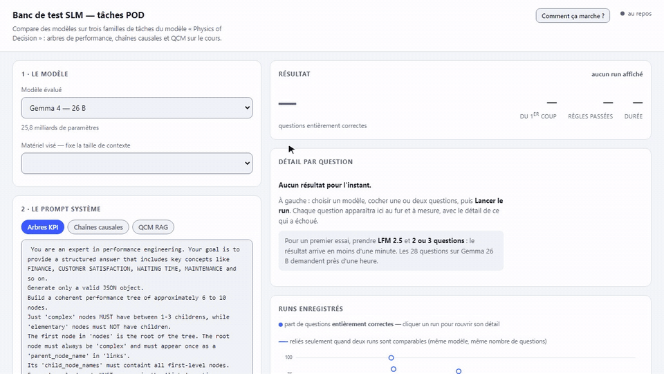

[English](README.md) · **Français**

# Banc d'évaluation de petits modèles

**Les mêmes 28 questions pour chaque petit modèle de langage, notées par des règles fixes, sans juge humain ni LLM-juge.** Construit pour choisir le modèle d'un agent qui tourne sur un casque de réalité virtuelle ou un téléphone.

*Une vraie série sur le banc, trois questions, attente accélérée. [Vidéo complète (0:57)](https://drive.google.com/file/d/1gXnF-XwPWri-0Vd6SohdAlpc8grxw0cy/view)*

## Ce qu'on fait avec

- **Trois réglages.** Le modèle, le matériel visé et le prompt système. Le matériel fixe la taille de contexte ; les appareils où le modèle ne tient pas sont retirés.
- **Jeu de questions.** 5 arbres d'indicateurs de performance, 6 chaînes causales, 17 QCM sur le cours, avec recherche dans ce cours (RAG).
- **Vérifications.** Chaque réponse est validée contre un schéma, puis vérifiée : structure de l'arbre ou de la chaîne, transitions autorisées entre types de nœuds, lettre exacte pour les QCM. Score principal : questions entièrement correctes.
- **Détail en direct.** Chaque question s'affiche dès qu'elle est notée. Elle s'ouvre sur les vérifications échouées, la réponse reçue et un graphe 3D de la réponse du modèle face à une réponse de référence.
- **Historique.** Prompts système enregistrés en versions par famille ; une modification non enregistrée est signalée dans l'historique. La courbe ne relie que des séries comparables.

## Architecture

Diagramme en français

## Déploiement

- **Hébergement.** Conteneur Docker sur un serveur de l'école, joignable seulement par le VPN de l'école, en service continu depuis juillet 2026.
- **Modèles.** Le serveur Ollama partagé de l'école, sur processeur en août 2026 et sur GPU le 16 novembre 2026 ; ses latences ne disent rien d'un casque. Le 16 novembre, seul Gemma 4 8B était installé : Gemma 4 26B et LFM2.5-1.2B sont proposés mais ne tournent plus.
- **Usage.** Fait pour un stage d'été encadré dans une école d'ingénieurs ; 146 séries enregistrées du 1er au 10 août 2026.
- **Pas encore fait.** Archiver le texte exact du prompt avec chaque série, répéter une question pour mesurer la variance, garder la sortie brute des échecs complets.
- **Pile.** Python, uv, pydantic-ai, Pydantic, LangChain, Chroma, nomic-embed-text, Three.js, Docker Compose.

---

**Anthony Hunt** · [ingevision.cloud](https://ingevision.cloud/?p=banc-slm) · [LinkedIn](https://www.linkedin.com/in/anthony-hunt-3948a9196) · [GitHub](https://github.com/anthohunt)

Le code, les questions et les résultats sont privés, dans le dépôt de l'école.
