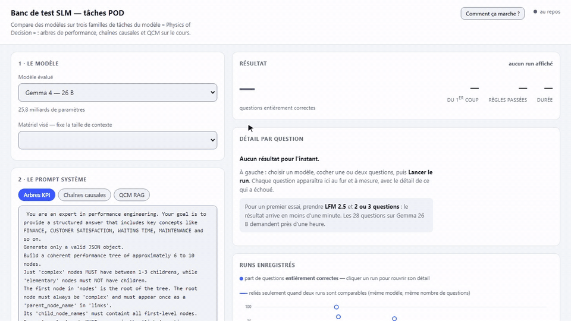
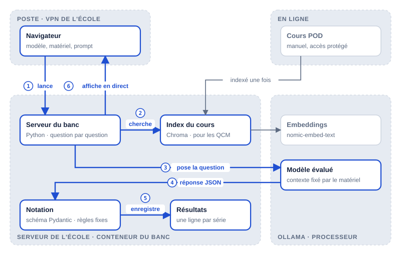

**English** · [Français](README.fr.md)

# Small-model benchmark

**The same 28 questions for every small language model, scored by fixed rules, with no human or LLM judge.** Built to choose a model for an agent that runs on a VR headset or a phone.

*A real run on the bench, three questions, waiting time sped up. [Full video (0:57)](https://drive.google.com/file/d/1gXnF-XwPWri-0Vd6SohdAlpc8grxw0cy/view)*

## Using it

- **Three settings.** The model, the target hardware and the system prompt. The hardware sets the context window; devices the model does not fit on are removed.
- **Question set.** 5 performance indicator trees, 6 causal chains, 17 multiple-choice questions on the course, answered with retrieval from it (RAG).
- **Checks.** Each answer is validated against a schema, then checked: tree or chain structure, allowed transitions between node types, exact letter for multiple choice. Main score: questions fully correct.
- **Live detail.** Each question appears as soon as it is scored. It opens on the failed checks, the raw answer and a 3D graph of the model's answer next to a reference answer.
- **History.** System prompts saved as versions per family; an unsaved edit is flagged in the history. The curve only links comparable runs.

## Architecture

French version

## Deployment

- **Hosting.** Docker container on a school server, reachable only through the school VPN, running continuously since July 2026.
- **Models.** The school's shared Ollama server, on CPU in August 2026 and on GPU on 16 November 2026; its latencies say nothing about a headset. On 16 November only Gemma 4 8B was installed: Gemma 4 26B and LFM2.5-1.2B are listed but no longer run.
- **Use.** Made for a supervised summer internship at an engineering school; 146 runs recorded between 1 and 10 August 2026.
- **Not done yet.** Storing the exact prompt text with each run, repeating a question to measure variance, keeping the raw output of complete failures.
- **Stack.** Python, uv, pydantic-ai, Pydantic, LangChain, Chroma, nomic-embed-text, Three.js, Docker Compose.

---

**Anthony Hunt** · [ingevision.cloud](https://ingevision.cloud/?lang=en&p=banc-slm) · [LinkedIn](https://www.linkedin.com/in/anthony-hunt-3948a9196) · [GitHub](https://github.com/anthohunt)

The code, questions and results are private, in the school's repository.
